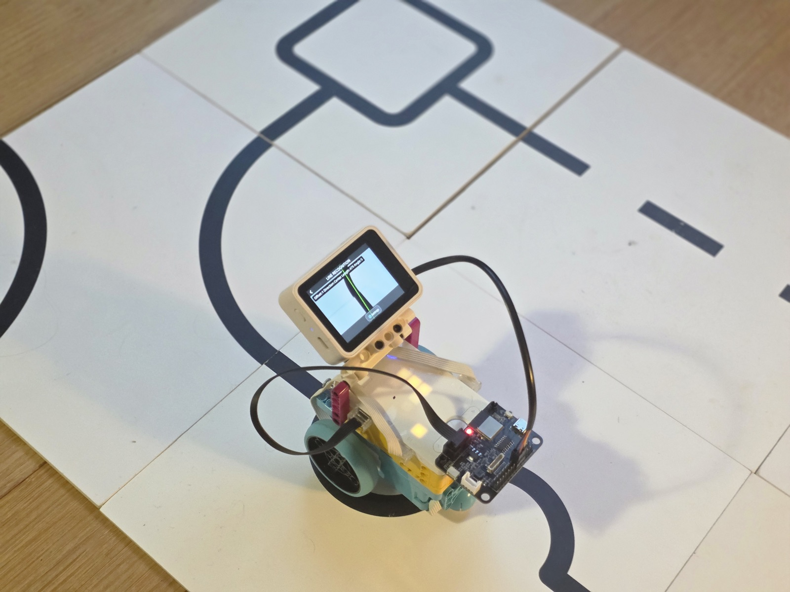
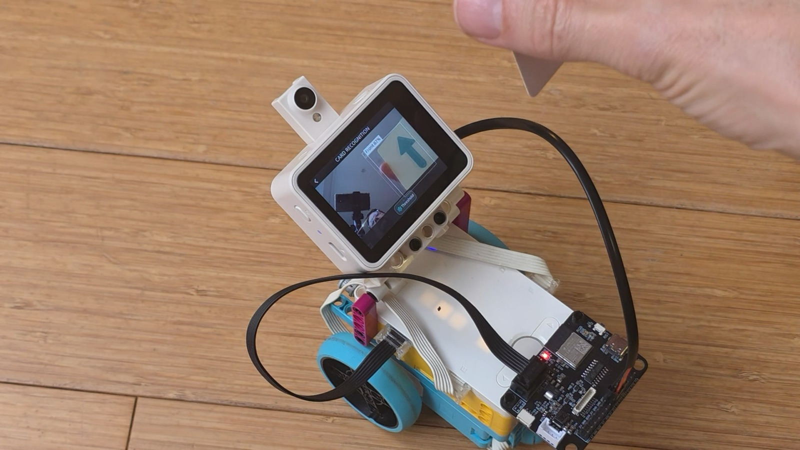
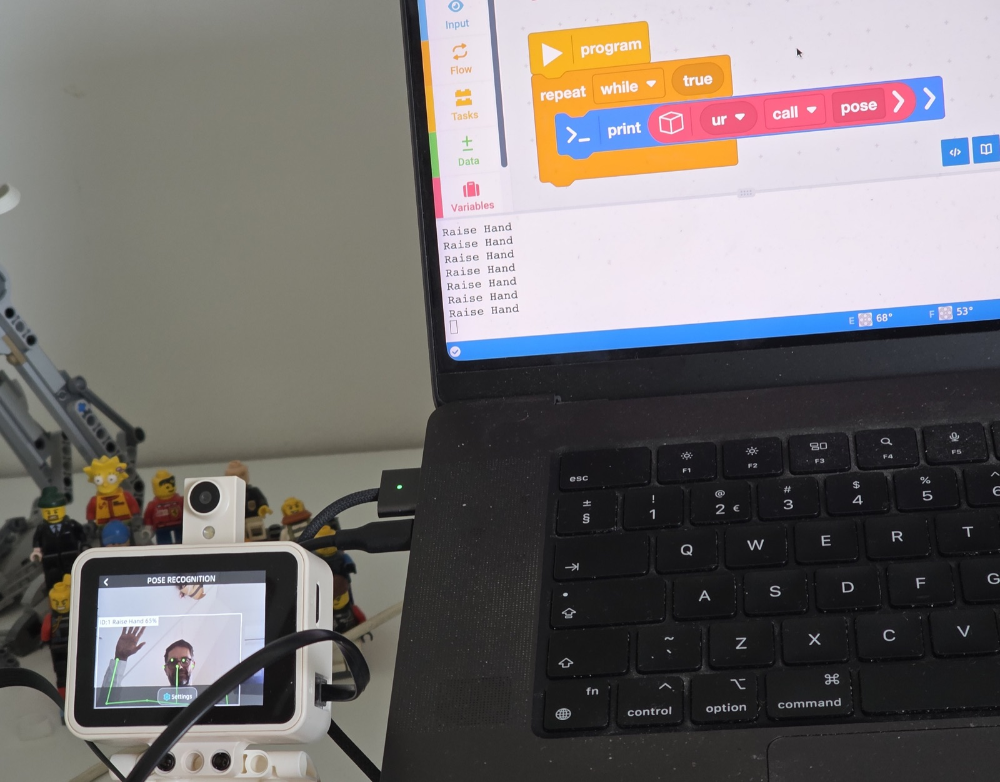
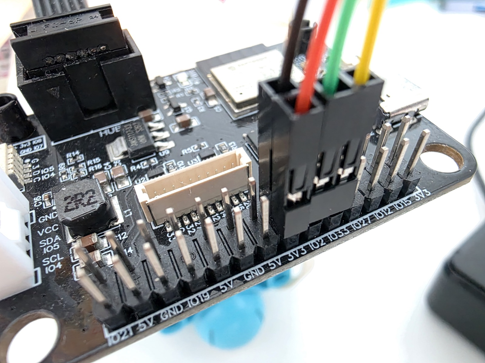

# AI Lens Pro for LEGO SPIKE Prime, MicroBlocks and MicroPython

**Give your LEGO robot AI vision.** Free libraries and classroom-ready examples for the **ELECFREAKS PlanetX AI Lens Pro** (EF05074) AI camera: follow a line, obey picture cards, and recognize poses with a LEGO® SPIKE™ Prime robot, an [LMS-ESP32](https://www.antonsmindstorms.com/product/powerful-lms-esp32-board-for-spike-and-mindstorms/) and Pybricks. Program it with blocks (MicroBlocks, Pybricks Blocks) or with Python (MicroPython).

Made by [Anton's Mindstorms](https://www.antonsmindstorms.com) for STEM teachers, robotics clubs and makers.



## What you can build

| Project | What the robot does | Code |
| --- | --- | --- |
| **AI line follower** | Follows a black line with sharp turns, gaps and chicanes. The camera sees the line ahead, so it steers smoother than a light sensor. | [uRemote](micropython/examples/uremote/) · [PUPRemote](micropython/examples/pupremote/) · [MicroBlocks](microblocks/) |
| **Card-controlled robot** | Show a picture card: *forward*, *turn around*, *left* or *right*, and the robot drives. | [uRemote](micropython/examples/uremote/) · [PUPRemote](micropython/examples/pupremote/) · [MicroBlocks](microblocks/) |
| **Pose recognition** | The hub prints the pose the camera sees, such as *Raise Hand*. | [uRemote](micropython/examples/uremote/) · [MicroBlocks](microblocks/) |

| Card recognition | Pose recognition |
| --- | --- |
|  |  |

## What you need

| Part | Notes |
| --- | --- |
| [ELECFREAKS AI Lens Pro](https://shop.elecfreaks.com?sca_ref=12706106.oeApChx3rLk5) (EF05074) | The AI camera. It has its own battery and screen. Use code **AN15** for 15% off at the ELECFREAKS shop. |
| [LMS-ESP32](https://www.antonsmindstorms.com/product/powerful-lms-esp32-board-for-spike-and-mindstorms/) | Connects the camera to a LEGO hub, and runs MicroPython or MicroBlocks. |
| LEGO SPIKE Prime or MINDSTORMS Robot Inventor hub | Running [Pybricks](https://code.pybricks.com). Our test robot drives with motors on ports E and F, with the LMS-ESP32 on port A. |
| A computer with Chrome or Edge | For the Pybricks and MicroBlocks web editors. |

No LEGO hub? The camera also works with a **micro:bit** in MicroBlocks, or on its own with the LMS-ESP32 in MicroPython.

## How it fits together

```text
AI Lens Pro  --I2C-->  LMS-ESP32  --LEGO cable-->  SPIKE Prime hub (Pybricks)
 (sees)                (reads the camera,           (asks "line?", "card?",
                        answers the hub)             "pose?" and drives)
```

The LMS-ESP32 runs a small program that answers questions from the hub: *where is the line?*, *which card do you see?* The hub program asks these questions in a loop and drives the motors. The LMS-ESP32 and the hub talk over [uRemote](https://github.com/AntonsMindstorms/uRemote) or [PUPRemote](https://github.com/antonvh/PUPRemote).

## Choose your path

| You want to… | Start here |
| --- | --- |
| Program everything with blocks | [MicroBlocks on the LMS-ESP32](microblocks/) + Pybricks Blocks on the hub |
| Use Python on the LMS-ESP32, blocks or Python on the hub | [uRemote examples](micropython/examples/uremote/) (line, cards, pose) |
| Use classic PUPRemote (deprecated) | [PUPRemote examples](micropython/examples/pupremote/) (line, cards) |
| Write your own MicroPython program | [MicroPython library and reference](micropython/) |
| Use a micro:bit | [MicroBlocks library](microblocks/) |

**uRemote or PUPRemote?** Not sure whether to use PUPRemote or uRemote? Choose uRemote instead! It is simpler and more stable. I sometimes had connection loss with pupremote.

## Wiring the AI Lens Pro to the LMS-ESP32

The camera talks I2C. Use the jumper wire that comes with the AI Lens Pro:

| AI Lens Pro wire | LMS-ESP32 pin |
| --- | --- |
| Black | GND |
| Red | 3V3 |
| Green (SCL) | IO2 |
| Yellow (SDA) | IO33 |



These are the pins on our test robot. Other pins work too, such as the LMS-ESP32 I2C header (SDA = IO5, SCL = IO4): change them at the top of the LMS-ESP32 program, or in the `AI Lens Pro init` block in MicroBlocks.

Then plug the LMS-ESP32 into **port A** of the hub with its LEGO cable, and **switch the AI Lens Pro on** (press its power button) before you start the programs.

## Both libraries support every AI Lens Pro function

Face recognition · facial expressions · gestures · poses with 17 body keypoints · 80 object classes · object tracking · red and blue balls · 35 picture cards · colors · line following · text recognition (OCR) · QR codes and barcodes · self learning · rhythm detection · the fill light · the lens' own Wi-Fi.

| Library | For |
| --- | --- |
| [microblocks/AI Lens Pro.ubl](microblocks/) | MicroBlocks on the LMS-ESP32, micro:bit and other boards |
| [micropython/ailenspro.py](micropython/) | MicroPython on the LMS-ESP32, or any MicroPython board with I2C |

Every result has the same properties: **x, y, width, height, id, name, confidence and color**. Results are sorted largest first, so result 1 is usually the nearest thing. Positions are the center of the target in a 640 × 480 image.

<details>
<summary>What <code>id</code> and <code>name</code> mean in each function</summary>

| Function | id | name |
| --- | --- | --- |
| cards | 0–34 | `0`…`9`, `A`…`E`, `forward` (15), `turn around` (16), `left` (17), `right` (18), `stop` (19), `cat`, `dog`, `mouse`, `apple`, `pear`, `grapes`, `airplane`, `car`, `ship`, `pen`, `ruler`, `microbit`, `clock`, `cup`, `umbrella` |
| objects | COCO class 0–79 | `person`, `cat`, `cup`, … |
| expressions | 0–6 | `angry`, `disgust`, `fear`, `happy`, `sad`, `surprise`, `neutral` (or the label the lens sends) |
| poses | 1–9 | the label the lens sends, such as `Raise Hand` |
| basic colors | 1–6 | `red`, `green`, `blue`, `white`, `black`, `yellow` |
| learned colors / self learning / gestures / faces | learned id (0 = unknown) | the name given on the lens |
| QR & barcodes | 1 = QR, 2 = barcode | the decoded content |
| text (OCR) | 0 | the text |
| balls | as sent by the lens | `ball` (use `red ball` / `blue ball` for the color) |

</details>

## FAQ

**Can I use the ELECFREAKS AI Lens Pro with LEGO SPIKE Prime?**
Yes. Connect the camera to an [LMS-ESP32](https://www.antonsmindstorms.com/product/powerful-lms-esp32-board-for-spike-and-mindstorms/), plug the LMS-ESP32 into the hub, and run Pybricks on the hub. The examples in this repository show line following, card recognition and pose recognition.

**Does it work with the LEGO SPIKE app (Scratch / Word Blocks)?**
These examples use Pybricks, which you can program with blocks or Python. Pybricks replaces the SPIKE firmware; you can switch back at any time.

**Do my students need to know Python?**
No. The LMS-ESP32 side can be MicroBlocks, and the hub side can be Pybricks Blocks. The screenshots in each example folder show the block programs.

**Can I use the AI Lens Pro with a micro:bit?**
Yes, with the [MicroBlocks library](microblocks/). Connect the camera to the I2C port of a PlanetX or Nezha expansion board.

**Why does the robot pause when it switches between cards and line following?**
The camera needs a few seconds to switch function. During that time the commands answer "nothing seen", so the robot waits instead of crashing.

**How is this different from a LEGO color sensor for line following?**
A color sensor sees one spot under the robot. The camera sees the line ahead, including its angle, so the robot can steer earlier and take sharp turns and chicanes at a higher speed.

## More from Anton's Mindstorms

- [LMS-ESP32](https://www.antonsmindstorms.com/product/powerful-lms-esp32-board-for-spike-and-mindstorms/): the WiFi Python ESP32 board for LEGO MINDSTORMS and SPIKE
- [LMS-ESP32 firmware](https://firmware.antonsmindstorms.com): flash MicroPython onto the LMS-ESP32 from your browser
- [uRemote](https://github.com/AntonsMindstorms/uRemote) and [PUPRemote](https://github.com/antonvh/PUPRemote): connect the LMS-ESP32 to LEGO hubs
- [antonsmindstorms.com](https://www.antonsmindstorms.com): building instructions, tutorials and robotics hardware for LEGO

## For developers

The I2C protocol comes from the official ELECFREAKS MakeCode extension ([pxt-PlanetX-AI](https://github.com/elecfreaks/pxt-PlanetX-AI)). The line-following result was decoded further on the real device: it also reports both ends of the line, its center and its length. The libraries were tested on hardware with the LMS-ESP32.

```sh
python3 tests/test_ailenspro.py     # MicroPython driver against a simulated lens
python3 tests/test_ubl_sim.py       # the MicroBlocks library, run in a small GP interpreter, same simulated lens
python3 tests/ubl_lint.py           # static checks of the .ubl (brackets, specs, argument counts, variables)
python3 tests/ubl_size.py           # compiled size per function (MicroBlocks allows at most 1000 bytes each)
```

Found a bug or built something cool? Open an issue or a pull request.

## License

Copyright © Anton's Mindstorms. The libraries and examples are free software under the [GNU General Public License v3.0](LICENSE): use them in class, change them and share them. If you distribute a changed version, share its source under the same license.
