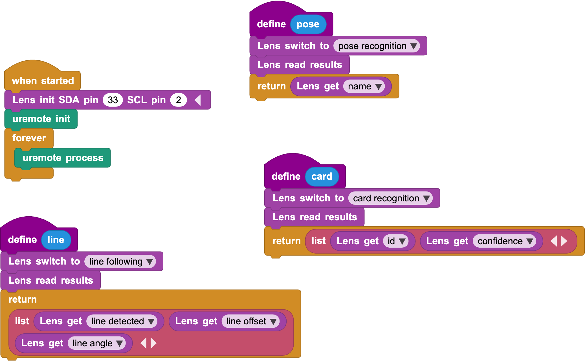

# AI Lens Pro library for MicroBlocks

Program the **ELECFREAKS AI Lens Pro** AI camera with blocks in [MicroBlocks](https://microblocks.fun), on an [LMS-ESP32](https://www.antonsmindstorms.com/product/powerful-lms-esp32-board-for-spike-and-mindstorms/), a micro:bit or another MicroBlocks board. Recognize cards, follow lines, detect poses, faces, objects and more.

| File | What it is |
| --- | --- |
| [AI Lens Pro.ubl](AI%20Lens%20Pro.ubl) | The library. Add it to any MicroBlocks project. |
| [ai_lens_uremote_microblocks.ubp](ai_lens_uremote_microblocks.ubp) | Example project: the LMS-ESP32 answers `line`, `card` and `pose` questions from a LEGO hub over uRemote. |

## Example: AI camera for a LEGO SPIKE Prime robot

The LMS-ESP32 runs this MicroBlocks program. A SPIKE Prime hub running Pybricks calls `line`, `card` or `pose`, and gets the answer from the camera.



### Step by step

1. **Wire the camera** to the LMS-ESP32 as shown in the [main README](../README.md#wiring-the-ai-lens-pro-to-the-lms-esp32). Our robot uses SDA = GPIO 33 and SCL = GPIO 2.
2. **Install MicroBlocks on the LMS-ESP32.** Open the [MicroBlocks editor](https://microblocks.fun/run/microblocks.html) in Chrome or Edge, connect the board with USB, and install the firmware from the editor's menu.
3. **Open the example.** Download [ai_lens_uremote_microblocks.ubp](ai_lens_uremote_microblocks.ubp) and drag it onto the editor (or use **File → Open**). It already contains the AI Lens Pro and uRemote libraries.
4. **Check the pins** in the `AI Lens Pro init` block. Change them if your camera is on other pins.
5. **Switch on the AI Lens Pro** and click the green flag. The program stays on the LMS-ESP32, so it also starts when the robot is switched on.
6. **Program the hub.** Plug the LMS-ESP32 into port A and use any of the Pybricks programs in the [uRemote examples folder](../micropython/examples/uremote/): line following, card driving or pose printing. They work unchanged with this MicroBlocks program.

### What the functions return

| Function | Returns | Used by |
| --- | --- | --- |
| `line` | line detected (true/false), line offset (−320 left … 320 right), line angle (degrees, negative = the line bends left) | the line follower |
| `card` | card id and confidence (%). The id is −1 when no card is seen; 15 = forward, 16 = turn around, 17 = left, 18 = right | the card-driving robot |
| `pose` | the name of the pose, such as `Raise Hand` | pose printing |

Each function switches the camera to the right mode first. Switching takes a few seconds, so the first answer after a switch is slower.

## Install the library in your own project

Drag [AI Lens Pro.ubl](AI%20Lens%20Pro.ubl) onto the MicroBlocks editor, or use **File → Open**. The blocks appear in a new **AI Lens Pro** category.

> **LMS-ESP32:** expand the `AI Lens Pro init` block (click its arrow) and set the SDA and SCL pins your camera is on. On a micro:bit, leave it collapsed and connect the camera to the I2C port of a PlanetX or Nezha expansion board (P19 = SCL, P20 = SDA).

### Example: card recognition on a micro:bit

```text
when started
  AI Lens Pro init
  AI Lens Pro switch to [card recognition]
  forever
    AI Lens Pro update
    if <AI Lens Pro sees [stop]>
      display (stop sign image)
    else if <AI Lens Pro sees [anything]>
      scroll text (AI Lens Pro [name])
```

Follow a ball: `AI Lens Pro switch to [ball recognition]`, then steer with `(AI Lens Pro [x] of result 1) - 320`.

## Block reference

The library has 13 blocks. MicroBlocks allows at most 256 functions and scripts per project, counting every loaded library, so less common features are grouped in two blocks with a menu. The library uses 29 of them.

| Block | What it does |
| --- | --- |
| `AI Lens Pro init : SDA pin _ SCL pin _` | Start I2C and wait for the lens. Expand it only to pick pins. Says a message when the lens is not found. |
| `AI Lens Pro switch to _` | Choose the function. Waits until the lens has switched. |
| `AI Lens Pro update` | Read new results. Call this once per loop. |
| `AI Lens Pro light _ %` | Fill light brightness 5–100 %, or 0 for off. |
| `AI Lens Pro sees _` | True when a result has this name or id. Also accepts `anything`, `red ball` and `blue ball`. |
| `AI Lens Pro count` | How many things the lens sees. |
| `AI Lens Pro _ of result _` | x, y, width, height, id, name, confidence or color of result 1, 2, … or of the first result with a name, such as `x of result stop`. Returns 0 (or empty text) when that result does not exist. The `color` property is an RGB color you can send straight to a NeoPixel block. |
| `AI Lens Pro find _` | Number of the first result with that name or id, or 0 if none. |
| `AI Lens Pro pose _ _` | Pose recognition: x or y of a body point (nose, wrists, knees…). −1 when it is not visible. |
| `AI Lens Pro [info ▾]` | Everything else the lens reports, chosen from the menu (see below). |
| `AI Lens Pro [command ▾] : _` | Settings and actions, chosen from the menu (see below). Expand the block to give a value. |
| `AI Lens Pro text region x1 _ y1 _ x2 _ y2 _` | Limit text recognition to part of the image. |
| `AI Lens Pro connect WiFi _ password _` | Connect the lens itself to Wi-Fi (for its remote file manager). |

The info block's menu:

| Info | Meaning |
| --- | --- |
| `name`, `id`, `confidence` | Of the largest result: the card, pose, object, gesture, face, … the lens sees. Empty text, −1 and 0 when it sees nothing (card id 0 is the card "0"). |
| `line offset`, `line angle`, `line detected`, `line direction` | Line following: offset −320 (left) … 320 (right) at the middle of the line, angle in degrees (negative = left), true/false, and `left`, `center`, `right` or `none` (angle beyond ±10°). |
| `tracking lost` | Object tracking: the tracked object is (temporarily) lost. |
| `blinks`, `mouth opens` | Face recognition counters. |
| `bpm`, `beats`, `rhythm duration (ms)`, `rhythm recognized` | Rhythm detection. |
| `text` | Recognized text (OCR) or QR / barcode content. |
| `closest to center` | Number of the result nearest the middle of the image. |
| `all results` | All results as a list of lists: `x y width height id name confidence color`. |
| `function` | Name of the active function (empty when the lens does not answer). |
| `connected`, `WiFi connected` | Whether the lens answers, and whether its Wi-Fi is connected. |

The command block's menu:

| Command | Value (expand the block) |
| --- | --- |
| `basic colors`, `learned colors` | Color recognition mode: the color in the center (red, green, blue, white, black, yellow), or colors learned on the lens (ids 1–30). Switches to color recognition if needed. |
| `start tracking`, `stop tracking` | Object tracking of the object in the center of the image. |
| `learn ID`, `forget ID` | Self learning: learn the object in the center as ID 1–30 (default 1); forget an ID, or everything with 0 (default). |
| `clear text region` | Read text everywhere again. |
| `record rhythm (s)` | Record 1–25 seconds (default 10) with the microphone of the lens. |
| `analyse sound file` | Rhythm detection on a .wav file on the SD card of the lens, such as `/sound_touch/test.wav`. |

What `id` and `name` mean per function is listed in the [main README](../README.md#both-libraries-support-every-ai-lens-pro-function).

## Notes

- The I2C bus runs at 100 kHz (the micro:bit / MakeCode default). The `init` block sets this for the whole bus.
- The lens runs on its own battery: switch it on before your program starts. Its I2C address is `0x60`.
- Wi-Fi details go to the lens in one I2C message. Boards with a small I2C buffer, such as the micro:bit, may not be able to send a long network name and password.

More LEGO robotics projects and the LMS-ESP32 board: [antonsmindstorms.com](https://www.antonsmindstorms.com).
