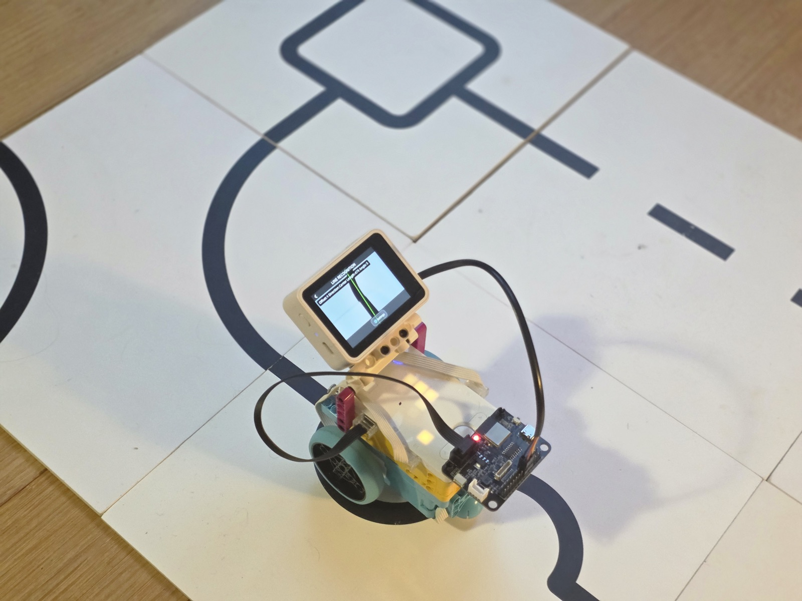
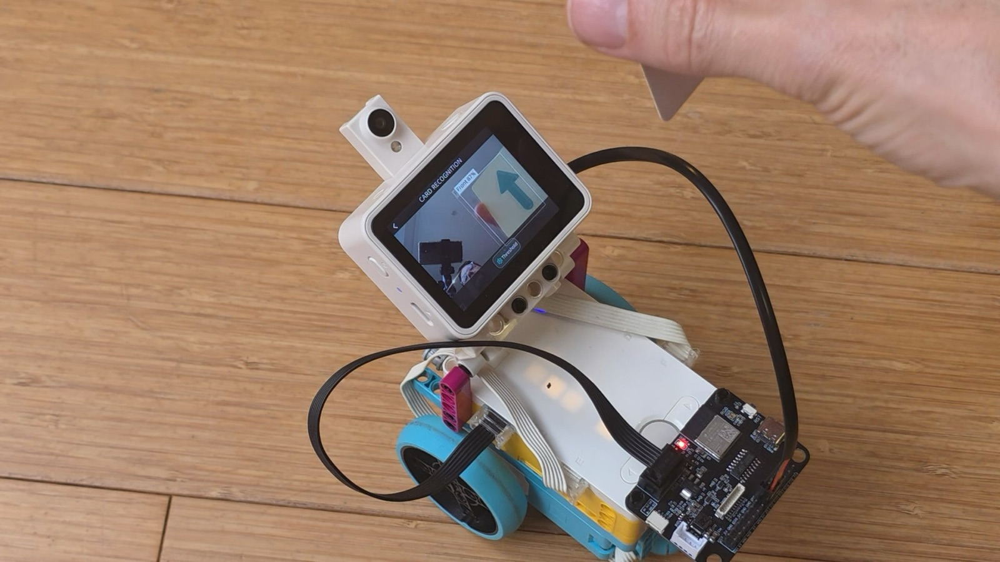

# AI line follower and card robot with PUPRemote

A **LEGO SPIKE Prime** robot with an **ELECFREAKS AI Lens Pro** camera and an [LMS-ESP32](https://www.antonsmindstorms.com/product/powerful-lms-esp32-board-for-spike-and-mindstorms/) follows a line or drives by picture cards. The hub runs the **standard Pybricks firmware** and talks to the LMS-ESP32 over [PUPRemote](https://github.com/antonvh/PUPRemote): the LMS-ESP32 acts like a LEGO sensor.

| File | Runs on | What it does |
| --- | --- | --- |
| [ai_lens_pupremote.py](ai_lens_pupremote.py) | LMS-ESP32 | Answers `line` and `card` questions from the hub. |
| [ai_lens_line_follow_pybricks.py](ai_lens_line_follow_pybricks.py) | SPIKE Prime hub | Follows a black line. |
| [ai_lens_card_pupremote_pybricks.py](ai_lens_card_pupremote_pybricks.py) | SPIKE Prime hub | Drives by picture cards. |

Not sure whether to use PUPRemote or uRemote? Choose uRemote instead! It is simpler and more stable. I sometimes had connection loss with pupremote.

## Set up the LMS-ESP32

1. Wire the camera to the LMS-ESP32 as shown in the [main README](../../../README.md#wiring-the-ai-lens-pro-to-the-lms-esp32).
2. Flash MicroPython with the [LMS-ESP32 firmware tool](https://firmware.antonsmindstorms.com). The firmware already contains PUPRemote.
3. Copy two files to the board, for example with Thonny:
   - [ailenspro.py](../../ailenspro.py), the AI Lens Pro library
   - [ai_lens_pupremote.py](ai_lens_pupremote.py), saved on the board as `main.py`
4. If your camera is on other pins than GPIO 2 (SCL, green wire) and GPIO 33 (SDA, yellow wire), change them at the top of `main.py`.
5. Switch on the AI Lens Pro and reset the LMS-ESP32.

## Set up the SPIKE Prime hub

1. Install [Pybricks](https://code.pybricks.com) on the hub.
2. Import [pupremote_hub.py](https://github.com/antonvh/PUPRemote/blob/main/src/pupremote_hub.py) into your Pybricks project.
3. Import one of the hub programs below. They open as **Pybricks Blocks**.
4. Plug the LMS-ESP32 into **port A**, the left wheel motor into **port F** and the right wheel motor into **port E**.
5. Run the program.

## Project 1: AI line follower

[ai_lens_line_follow_pybricks.py](ai_lens_line_follow_pybricks.py)

Every loop, the hub calls `line` and gets three numbers: `detected` (1 or 0), the offset of the line from the center of the image (−320 left … 320 right), and the angle of the line in degrees (negative when it bends left).

The robot steers with both: `turn = -offset / 5 - angle × 2 / 5`. It slows down in sharp bends with `speed = 40 - |angle| / 4`, and sets the motor power of each wheel to `speed ± turn / 4`.

**Try this with your students:** change the factors and the base speed of 40. What happens with only the offset, or only the angle?

## Project 2: Card-controlled robot

[ai_lens_card_pupremote_pybricks.py](ai_lens_card_pupremote_pybricks.py)

The hub calls `card` and gets the id and confidence of the largest card:

| Card | id | Robot |
| --- | --- | --- |
| forward | 15 | drives 100 mm forward |
| turn around | 16 | drives 100 mm back |
| right | 18 | turns 90° right |
| left | 17 | turns 90° left |

When no card is seen, the id is −1. All 35 card ids are listed in the [main README](../../../README.md#both-libraries-support-every-ai-lens-pro-function).

## How the LMS-ESP32 program works

PUPRemote needs to know the data format of every command, on both sides:

| Command | Format | Values |
| --- | --- | --- |
| `line` | `'bhh'` | detected, offset, angle |
| `card` | `'bb'` | card id, confidence |

The LMS-ESP32 switches the camera to the right mode by itself. Switching takes a few seconds; in that time it answers "nothing seen" right away, so the hub keeps its connection to the "sensor".

More robotics projects with the LMS-ESP32: [antonsmindstorms.com](https://www.antonsmindstorms.com).
