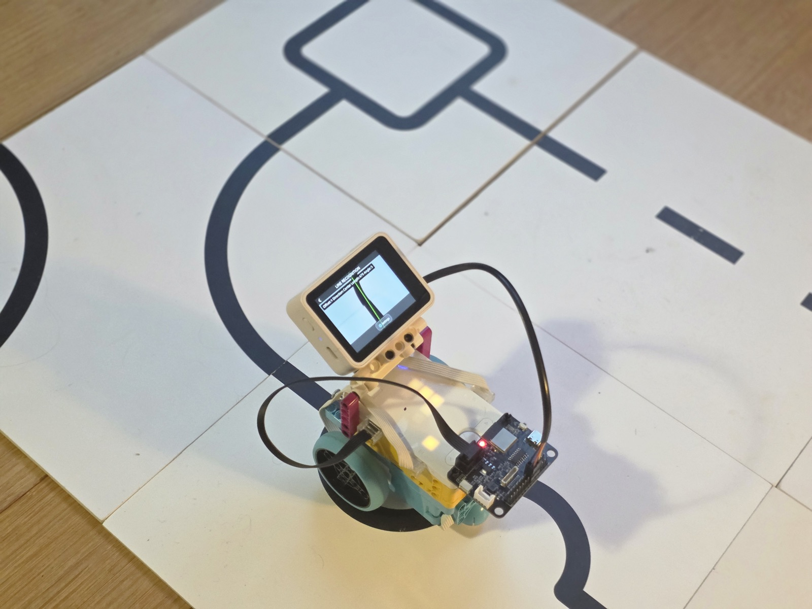
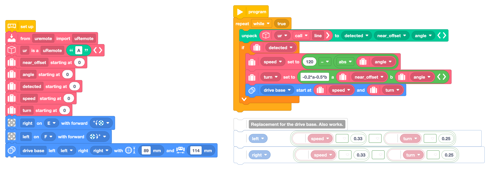
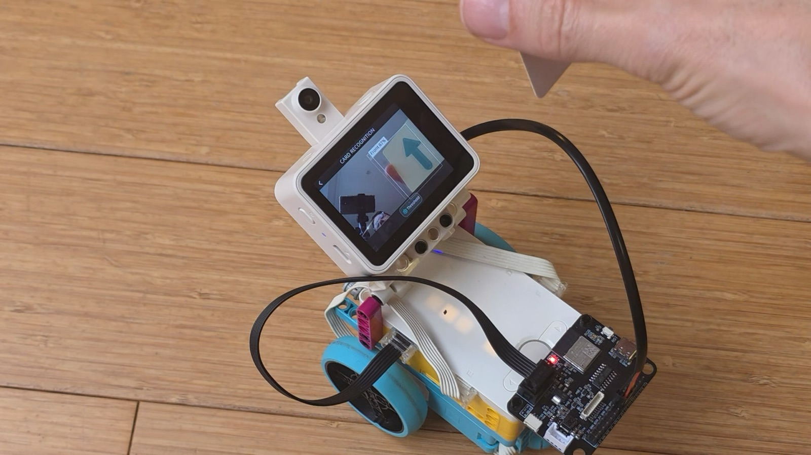
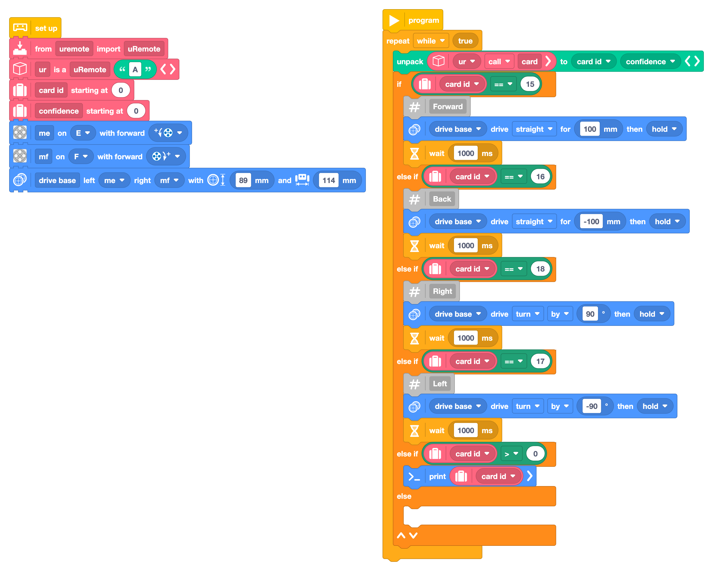
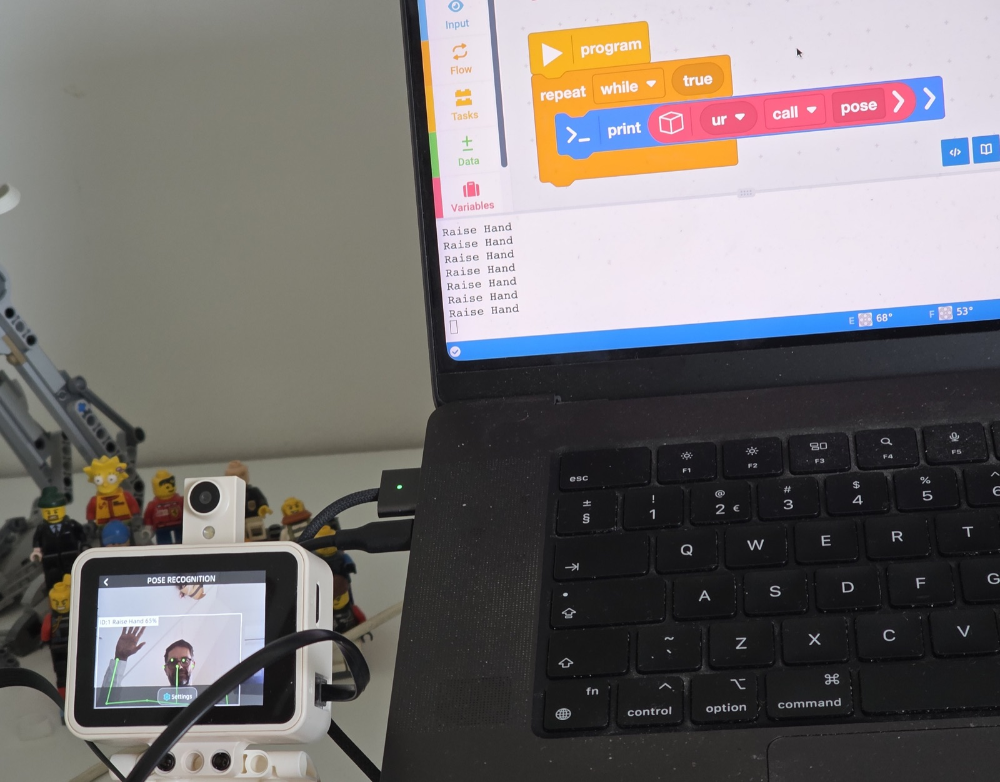
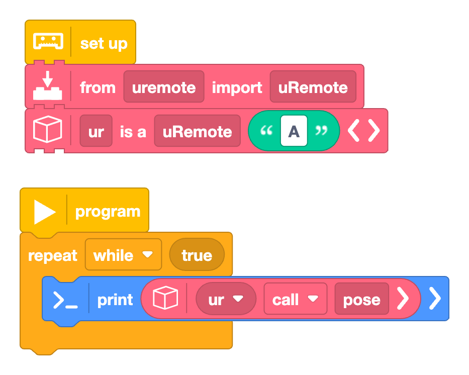

# AI line follower, card robot and pose recognition with uRemote

Three classroom projects for a **LEGO SPIKE Prime** robot with an **ELECFREAKS AI Lens Pro** camera and an [LMS-ESP32](https://www.antonsmindstorms.com/product/wifi-python-esp32-board-for-mindstorms/). The hub runs Pybricks (blocks or Python) and asks the LMS-ESP32 what the camera sees, over [uRemote](https://github.com/AntonsMindstorms/uRemote).

| File | Runs on | What it does |
| --- | --- | --- |
| [ai_lens_uremote.py](ai_lens_uremote.py) | LMS-ESP32 | Answers `line`, `card` and `pose` questions from the hub. |
| [ai_lens_line_follow_ur.py](ai_lens_line_follow_ur.py) | SPIKE Prime hub | Follows a black line. |
| [ai_lens_card_ur_pybricks.py](ai_lens_card_ur_pybricks.py) | SPIKE Prime hub | Drives by picture cards. |
| [ai_lens_pose_pybricks.py](ai_lens_pose_pybricks.py) | SPIKE Prime hub | Prints the pose the camera sees. |

Prefer blocks on the LMS-ESP32 too? Use the [MicroBlocks version](../../../microblocks/) instead of `ai_lens_uremote.py`. The hub programs stay the same.

## Set up the LMS-ESP32

1. Wire the camera to the LMS-ESP32 as shown in the [main README](../../../README.md#wiring-the-ai-lens-pro-to-the-lms-esp32).
2. Flash MicroPython with the [LMS-ESP32 firmware tool](https://firmware.antonsmindstorms.com).
3. Copy three files to the board, for example with Thonny:
   - [ailenspro.py](../../ailenspro.py), the AI Lens Pro library
   - [uremote.py](https://github.com/AntonsMindstorms/uRemote/blob/main/library/uremote.py), the uRemote library
   - [ai_lens_uremote.py](ai_lens_uremote.py), saved on the board as `main.py`
4. If your camera is on other pins than GPIO 2 (SCL, green wire) and GPIO 33 (SDA, yellow wire), change them at the top of `main.py`.
5. Switch on the AI Lens Pro and reset the LMS-ESP32.

## Set up the SPIKE Prime hub

1. Install a [Pybricks firmware with UARTDevice](https://github.com/AntonsMindstorms/uRemote#1-flash-pybricks-firmware-with-uartdevice) on the hub. uRemote needs it; the standard Pybricks firmware doesn't have it.
2. Open [code.pybricks.com](https://code.pybricks.com) and import [uremote.py](https://github.com/AntonsMindstorms/uRemote/blob/main/library/uremote.py) into your project.
3. Import one of the hub programs below. They open as **Pybricks Blocks**, so students can read and change them as blocks.
4. Plug the LMS-ESP32 into **port A**, the left wheel motor into **port F** and the right wheel motor into **port E**.
5. Run the program.

## Project 1: AI line follower

[ai_lens_line_follow_ur.py](ai_lens_line_follow_ur.py)

Every loop, the hub calls `line` and gets three numbers:

| Value | Meaning |
| --- | --- |
| `detected` | 1 when the camera sees a line, 0 when not |
| `near_offset` | How far the line is from the center of the image: −320 (far left) … 320 (far right) |
| `angle` | The angle of the line in degrees. Negative when the line bends left, positive when it bends right. |

The robot steers with both: `turn = -0.2 × offset - 0.5 × angle`. The offset brings the robot back onto the line; the angle makes it turn into a bend before it gets there. In sharp bends the robot slows down: `speed = 120 - |angle|`.

**Try this with your students:**

- Change 0.2 and 0.5. What happens with only the offset (angle factor 0)? With only the angle?
- Raise the base speed of 120. How fast can the robot go before it loses the line?
- What should the robot do when `detected` is 0, at a gap in the line?

## Project 2: Card-controlled robot

[ai_lens_card_ur_pybricks.py](ai_lens_card_ur_pybricks.py)

The hub calls `card` and gets the id and confidence of the largest card the camera sees. The robot drives 100 mm forward or back, or turns 90°:

| Card | id | Robot |
| --- | --- | --- |
| forward | 15 | drives 100 mm forward |
| turn around | 16 | drives 100 mm back |
| right | 18 | turns 90° right |
| left | 17 | turns 90° left |

Other cards print their id in the terminal. When no card is seen, the id is −1. All 35 card ids are listed in the [main README](../../../README.md#both-libraries-support-every-ai-lens-pro-function).

**Try this with your students:** program a route with cards, or use the `stop` card (id 19) to stop the robot. Use the confidence to ignore cards the camera isn't sure about.

## Project 3: Pose recognition

[ai_lens_pose_pybricks.py](ai_lens_pose_pybricks.py)

The hub calls `pose` and prints the name of the pose the camera sees, such as `Raise Hand`. It prints −1 when nobody is in view.

**Try this with your students:** make the robot dance, wave or drive when someone raises a hand.

## Switching between projects

Each command puts the camera in the right mode by itself: run the line follower, then the card robot, and the camera switches. Switching takes a few seconds. In that time the LMS-ESP32 answers "nothing seen" right away, so the hub never waits too long for an answer.

## Troubleshooting

| Problem | Try this |
| --- | --- |
| `No data` error on the hub | Is the LMS-ESP32 on port A, running `main.py`? Does the hub have the Pybricks firmware with UARTDevice? |
| The robot doesn't react | Is the AI Lens Pro switched on? Check the pins at the top of `main.py`. |
| The robot steers the wrong way | Swap the motor ports, or the sign of the turn factors. |

More robotics projects with the LMS-ESP32: [antonsmindstorms.com](https://www.antonsmindstorms.com).
